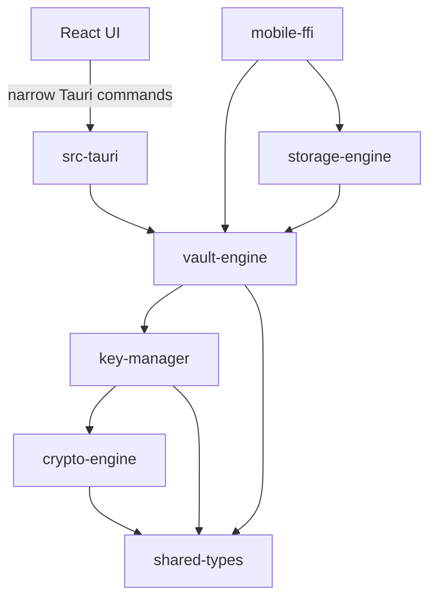

# SecureVault Architecture (Phase 1)

> **Status: core implemented, unreviewed.** Crypto, key management, vault,
> storage, sync planning and the mobile facade exist with tests, but have had no
> independent security review, there is no server authentication (OPAQUE) yet,
> and the desktop Secret Key is not yet kept in an OS keystore (re-entered at each unlock). Not safe for real secrets.

## Repository layout

The monorepo lives alongside the existing Flutter app (repo root: `lib/`,
`android/`, `windows/`, `linux/`), which is unchanged.

| Path | Purpose | Phase 1 state |
|------|---------|---------------|
| `apps/desktop` | Tauri 2 shell + React/TS/Vite UI | Wired to the core: create account (Secret Key shown once), unlock, lock, 5-min auto-lock, add/list/reveal/delete logins, password generator |
| `apps/browser-extension`, `apps/mobile`, `apps/admin-console` | Future clients | Empty (`.gitkeep`) |
| `crates/shared-types` | IDs, key/format versions | Implemented + tests |
| `crates/crypto-engine` | AEAD / KDF / RNG | Implemented per ADR-0001; not independently reviewed |
| `crates/key-manager` | Lock/unlock, wrapped vault keys, rotation | Implemented per ADR-0001; not independently reviewed |
| `crates/vault-engine` | Item storage **trait** | Interface only |
| `crates/{storage,sync}-engine`, `password-generator`, `platform-security` | Future | Empty |
| `backend/` | Go REST API | Health, config, bearer-auth sync API (`GET/PUT/DELETE /v1/vaults/{vault}/items`) with optimistic concurrency, tombstones, cursor feed, role checks. In-memory store only; enabled with `SECUREVAULT_DEV_SYNC=1` + `SECUREVAULT_DEV_TOKEN` (>=32 chars). No OPAQUE login or Postgres store yet. |
| `backend/migrations` | PostgreSQL schema (golang-migrate format) | Draft schema |
| `infrastructure/` | Docker dev DB; Terraform/monitoring placeholders | Dev Postgres only |

## Dependency direction

## Principles (from the master spec)

- The frontend performs **no** cryptography; it only calls explicitly
  allowed Tauri commands. The capability file grants no fs/shell/process.
- The backend stores only ciphertext and public metadata, and never receives
  the master password.
- Keys are purpose-separated and versioned (`KeyPurpose`, `KeyVersion`).
- Algorithms are **not yet selected**. Candidates (Argon2id,
  XChaCha20-Poly1305, HKDF-SHA-256) require a reviewed design in Phase 2.

## Open decisions (must be resolved before implementation)

1. Authentication scheme (e.g. augmented PAKE vs. server-side hash of a
   client-derived value): `auth_credentials.scheme/verifier` is opaque.
2. Ciphertext envelope layout (`Sealed` is deliberately opaque).
3. Account recovery and shared-vault key distribution protocols.
4. Whether local storage uses SQLite or another engine (`storage-engine`).

## Tooling notes

- Migrations use the [golang-migrate](https://github.com/golang-migrate/migrate)
  file convention (`NNNNNN_name.up.sql` / `.down.sql`).
- CI: `.github/workflows/ci.yml` (Rust fmt/clippy/test, frontend
  lint/typecheck/test, Go fmt/vet/test, migration apply/revert on Postgres).
